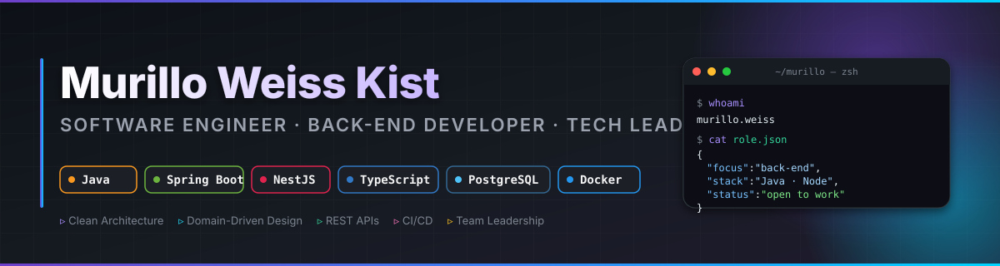

<h1 align="center">Murillo Weiss Kist</h1>
<h3 align="center">Software Engineer · Back-end Developer · Tech Lead</h3>

<p align="center">
  
</p>

<p align="center">
  <a href="https://portfolio.weissmurillo.de/">
    
  </a>
  <a href="https://www.linkedin.com/in/murillo-weiss-kist-6aa2a1279">
    
  </a>
  <a href="mailto:weissmurillo.dev@gmail.com">
    
  </a>
  <a href="https://github.com/ZzPowerTech?tab=followers">
    
  </a>
  <a href="https://github.com/ZzPowerTech">
    
  </a>
</p>

---

## Sobre mim

Engenheiro de software backend formado pelo Centro Universitário FAG (2023–2026), com **3+ anos** liderando produtos reais em produção. Atuo de ponta a ponta: arquitetura de back-end, APIs escaláveis e gestão técnica de equipe. Meu foco está em **Java/Spring Boot** e **Node/NestJS**, escrevendo código limpo, testável e orientado a domínio.

Hoje sou cofundador da **GWNext** e desenvolvo o backend da **[AgroConIA](https://www.agroconia.com.br/)**, plataforma que calcula o IBS e a CBS da reforma tributária na nota do produtor rural. De junho de 2025 a outubro de 2026 fui Head de Games e líder técnico da **AusTV Network**, rede de servidores Minecraft, liderando uma equipe de 15 pessoas.

Portfólio completo, projetos e contato: **[portfolio.weissmurillo.de](https://portfolio.weissmurillo.de/)**

```yaml
nome:         Murillo Weiss Kist
idade:        20 anos
localização:  Brasil · GMT-3
formação:     Engenharia de Software — Centro Universitário FAG (2023–2026)
atual:        Cofundador da GWNext · Backend da AgroConIA
portfólio:    https://portfolio.weissmurillo.de
foco:         Back-end · Clean Architecture · SDD · LLMs & MCPs · Liderança técnica
status:       Aberto a oportunidades (Júnior · Pleno)
```

---

## O que entrego

- **Back-end robusto** — APIs REST com NestJS e serviços em Java/Spring Boot, autenticação JWT, validação de domínio e cobertura de testes
- **Arquitetura limpa** — separação clara entre domínio, aplicação e infraestrutura; SOLID aplicado ao dia a dia
- **Banco de dados** — modelagem relacional em PostgreSQL com Prisma/JPA, otimização de queries e migrações versionadas
- **Plugins Minecraft** — desenvolvimento Java avançado (Spigot/Paper), integração com Redis, MySQL e mensageria entre servidores
- **Liderança técnica** — gestão de squad, code review, planejamento de sprints e mentoria de devs juniores
- **IA aplicada ao dev** — uso prático de **LLMs (Claude, GPT)**, **MCPs (Model Context Protocol)** e agentes para acelerar engenharia, automação e workflows internos
- **Produto** — definição de roadmap e priorização, da AusTV Network à AgroConIA

---

## Stack principal

<p align="center">
  
</p>

<table align="center">
<tr>
<td valign="top" width="33%">

#### Back-end
- Java · Spring Boot
- NestJS · Node.js
- REST APIs · JWT
- Clean Architecture · SDD (Spec-Driven Development)

</td>
<td valign="top" width="33%">

#### Dados & Infra
- PostgreSQL · Prisma · JPA
- Redis · Docker
- Linux · CI/CD
- Git · GitHub Actions

</td>
<td valign="top" width="33%">

#### Front-end & Tools
- Angular · React · TypeScript
- VS Code · Postman
- Figma · Obsidian
- Bukkit / Paper API

</td>
</tr>
</table>

---

## Projetos em destaque

### AgroConIA — Cofundador & Backend (GWNext)
Plataforma para a reforma tributária do agro. Calcula o IBS e a CBS de cada produto na nota do produtor rural (NF-e 4.00), avisa o que conferir antes de emitir e envia a nota para o escritório de contabilidade aprovar. Inclui a Ceres, assistente de IA que responde citando a EC 132/2023 e a LC 214/2025.

> Site: [agroconia.com.br](https://www.agroconia.com.br/)

### AusTV Network — Head de Games & Líder técnico (jun/2025 – out/2026)
Rede de servidores Minecraft 1.21.8 com arquitetura multi-servidor, plugins proprietários em Java e ecossistema de gameplay customizado. Encerrada em outubro de 2026.

- **Arquitetura:** servidores distribuídos com proxy Velocity, comunicação via Redis e persistência em MySQL
- **Engenharia:** plugins Java com sistema de relíquias, economia integrada, lootboxes e PvP balanceado (1.8/1.9)
- **Liderança:** equipe técnica de 15 pessoas, code review, agenda de eventos e roadmap de conteúdo

> Todos os projetos, incluindo hackathons e código aberto: [portfolio.weissmurillo.de](https://portfolio.weissmurillo.de/)

---

## GitHub em números

<p align="center">
  
  
</p>

<p align="center">
  
</p>

<p align="center">
  
</p>

<p align="center">
  
</p>

<p align="center">
  
  
</p>

---

## Hoje estou focado em

- Aprofundando **Spring Boot, JPA e arquitetura hexagonal** em projetos backend
- Explorando **LLMs, MCPs (Model Context Protocol) e agentes** aplicados a workflows de engenharia
- Construindo skills, plugins e integrações próprias com **Claude Code / Anthropic SDK**
- Construindo o backend da **AgroConIA** para a reforma tributária (IBS e CBS)
- Estudando **Docker, CI/CD e observabilidade** para deploys mais previsíveis
- Refinando práticas de **Clean Code, testes automatizados e SDD (Spec-Driven Development)**

### Aberto a colaborações em
- Back-end em **Java/Spring** ou **Node/NestJS**
- Projetos com forte componente de **arquitetura e modelagem de domínio**
- Liderança técnica, mentoria e organização de squads

---

## Para recrutadores

Se você está montando um time de back-end e procura alguém que une **engenharia sólida** com **maturidade de liderança** desde cedo, vamos conversar. Tenho preferência por times com cultura de code review, testes e crescimento técnico.

<p align="center">
  <a href="https://portfolio.weissmurillo.de/">
    
  </a>
  <a href="https://www.linkedin.com/in/murillo-weiss-kist-6aa2a1279">
    
  </a>
  <a href="mailto:weissmurillo.dev@gmail.com">
    
  </a>
</p>

<p align="center">
  <i>"A tecnologia é a ponte entre a imaginação e a realidade."</i>
</p>
